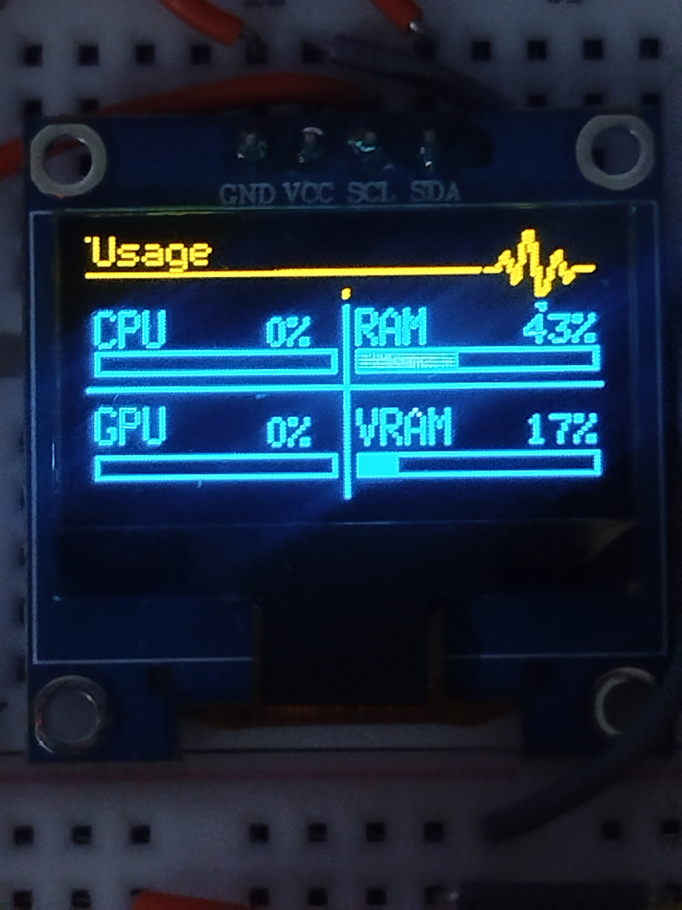
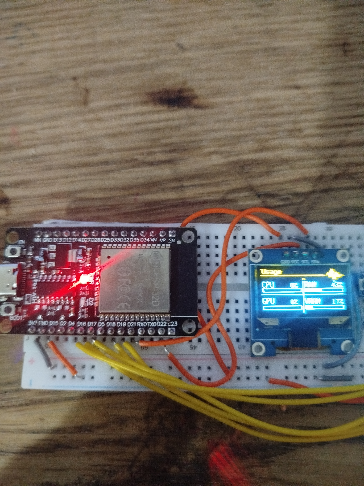
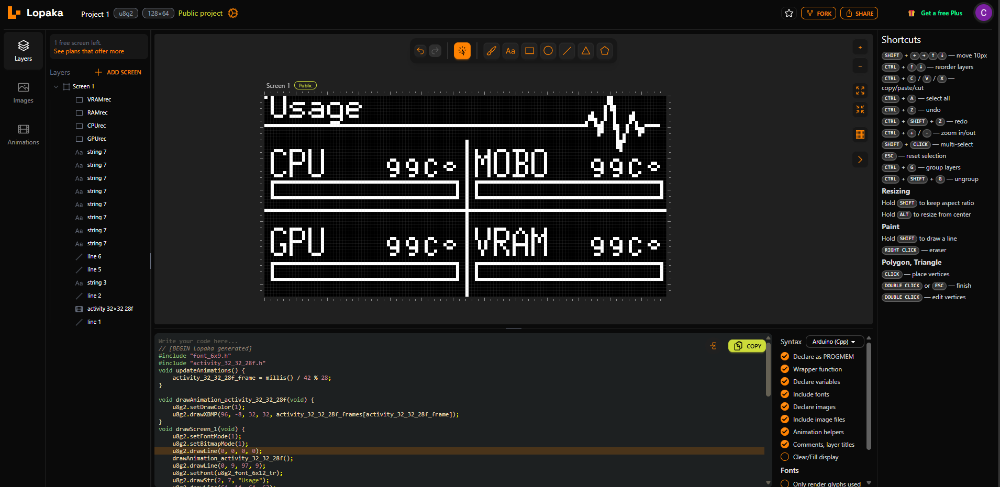
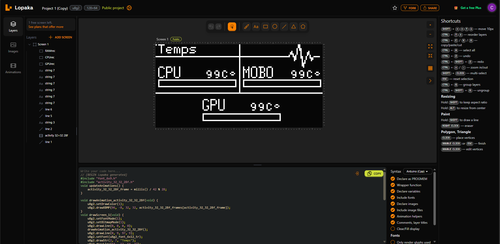
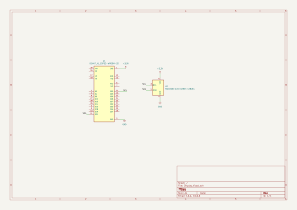

# DeckStat

This is my Half Life Week 4 project. I made a small PC stats display using an ESP32 and an OLED screen. It shows CPU, RAM, GPU and VRAM usage, so I can see what my computer is doing without opening another window.





## How it works

The Python script reads the usage from the computer and sends it to the ESP32 through the USB cable. It sends one line of numbers at a time, like `11,45,32,34`. The numbers mean CPU, RAM, GPU and VRAM, in that order. Both sides use 115200 baud and the ESP32 updates the screen when it gets a new line.

The screen layout came from Lopaka. I made two screens while working on it but I kept the usage screen because it was simpler and had the information I wanted. The animation bitmap used by the firmware is included in the Firmware folder too.

here's the link to the lopaka project (if you want you can fork it and edit it ): https://lopaka.app/canvas/59863

These are the two Lopaka designs I tried. I dropped the temperature screen, so it is only here to show how the design changed. The firmware only uses the usage screen.





The project is made from an ESP32 and a 0.96-inch OLED screen. I wired them together and made the schematic in KiCad. The schematic is in the Hardware folder.

I did not make a custom PCB for this project. Because it's unecessary would look ugly and would overall make the project more expensive.

## How to use it

1. Install Arduino IDE, the ESP32 board package, and the U8g2 library.
2. Open `Firmware/DeckStat.ino`, choose **ESP32 Dev Module**, choose the ESP32 COM port, and upload it.
3. Install Python 3 and the Python libraries:

   ```powershell
   py -m pip install pyserial psutil nvidia-ml-py
   ```

4. Change `PORT` near the top of `Firmware/Script.py` to the ESP32 COM port you are using.
5. Close Arduino Serial Monitor then run the script.

The Python script uses NVIDIA NVML for GPU and VRAM usage readings. If you don't have an NVIDIA GPU those two readings stay at zero.

## Wiring

| OLED screen | ESP32 |
| --- | --- |
| VCC | 3V3 |
| GND | GND |
| SDA | GPIO 21 |
| SCL | GPIO 22 |



## Bill of materials


| Part | Quantity | Price | Link |
| --- | --- | --- | --- |
| ESP32 DevKit V1 (ESP32-WROOM-32) | 1 | $3.30 |(https://it.aliexpress.com/item/1005006141235306.html?spm=a2g0o.cart.0.0.201818fcFu4SXf&mp=1&pdp_npi=6%40dis%21USD%21USD+3.30%21USD+3.04%21%21USD+3.04%21%21%21%400b15841617935294210645322e0cf2%2112000035944225407%21ct%21IT%218194849047%21%211%210%21&gatewayAdapt=glo2ita) |
| 0.96-inch SSD1306 I2C OLED display, 128x64 | 1 | $4.59 | (https://it.aliexpress.com/item/1005008961336797.html?spm=a2g0o.productlist.main.2.706278f5gd0G63&algo_pvid=bfeca7f6-9c52-458e-9af2-d011b571c761&algo_exp_id=bfeca7f6-9c52-458e-9af2-d011b571c761-1&pdp_ext_f=%7B%22order%22%3A%2279%22%2C%22eval%22%3A%221%22%2C%22fromPage%22%3A%22search%22%7D&pdp_npi=6%40dis%21USD%214.98%214.48%21%21%214.98%214.48%21%4021038a8017935296863165807e0dd6%2112000047383115035%21sea%21IT%218194849047%21ABX%211%210%21n_tag%3A-29910%3Bd%3A9393596c%3Bm03_new_user%3A-29895&curPageLogUid=ZqfXIm74dfGH&utparam-url=scene%3Asearch%7Cquery_from%3A%7Cx_object_id%3A1005008961336797%7C_p_origin_prod%3A) |

The full parts list is also in [`BOM.csv`](BOM.csv).

## Project files

- `Firmware/DeckStat.ino` — ESP32 firmware
- `Firmware/Script.py` — Python script that reads and sends PC usage
- `Firmware/activity_32_32_28f.h` — Lopaka animation bitmap used by the firmware
- `Hardware/Display.kicad_sch` — KiCad schematic
- `Hardware/Display.kicad_pro` — KiCad project settings
- `Pictures/` — photos of the working screen and the wired build
- `BOM.csv` — parts list

I had to troubleshoot the serial connection a few times before the numbers showed up properly. I used AI for some help with the Python part because I'm still learning Python, and I am focusing more on C++ at school and at home.
